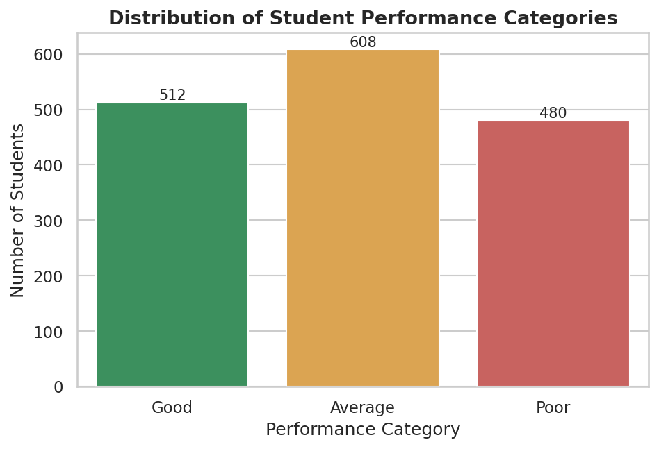
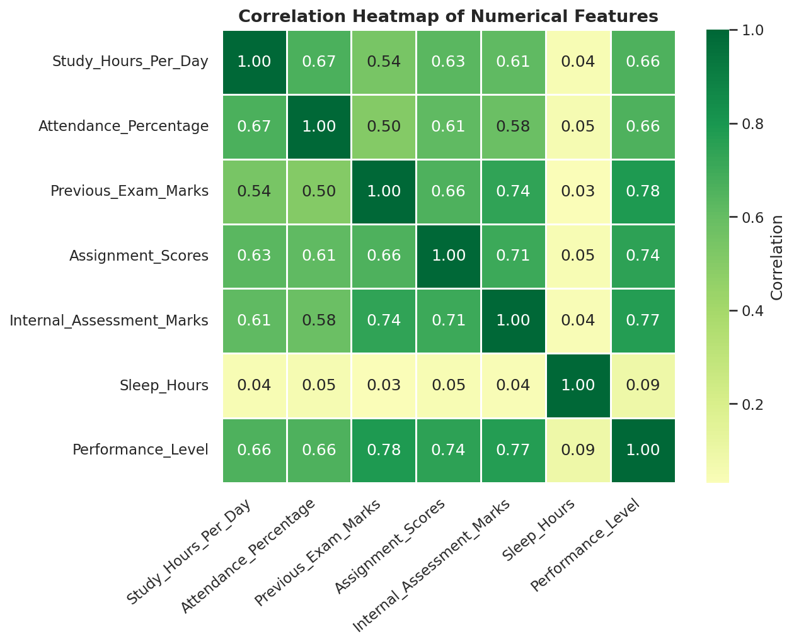
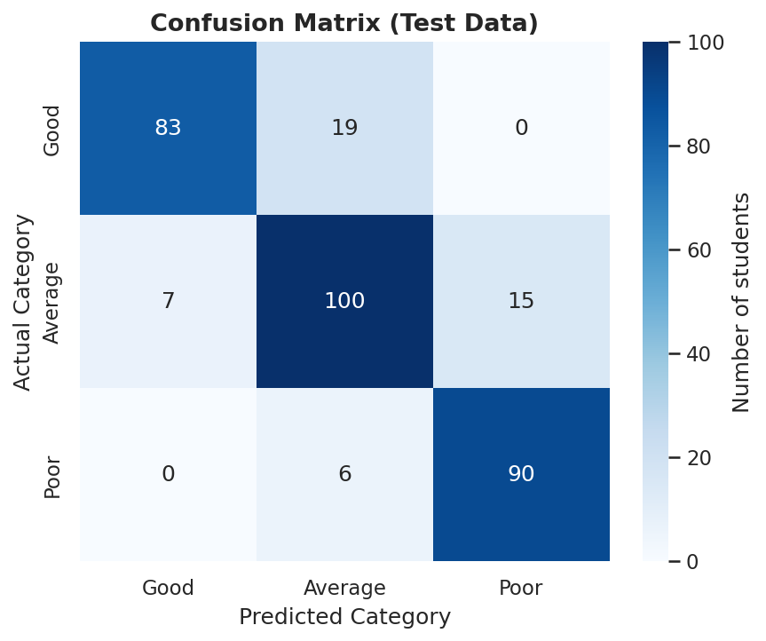
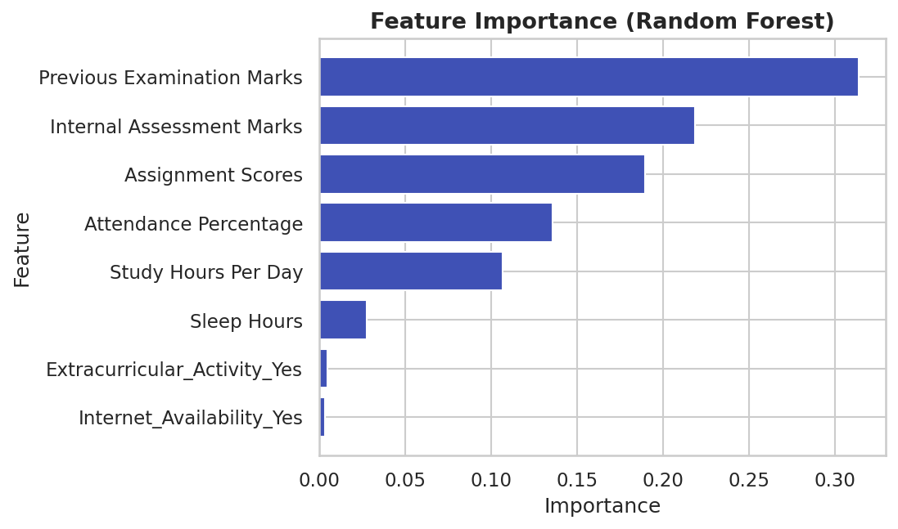

# STUDENT PERFORMANCE PREDICTION SYSTEM USING RANDOM FOREST CLASSIFIER

**A Mini Project Report in Artificial Intelligence and Machine Learning**

Submitted by: ______________________  Roll No.: ____________
Guide: ______________________  Department / College: ______________________  Academic Year: ____________

> All numerical results in this report were produced by running `generate_dataset.py` and `train_model.py` (seed 42, scikit-learn 1.8.0). The dataset is **synthetically generated**.

---

## 1. Abstract

Identifying students who are likely to perform poorly *before* the final examination allows teachers to offer timely support. This project develops a **Student Performance Prediction System** that classifies a student's expected academic performance as **Good, Average or Poor**. A synthetic structured dataset of 1,600 unique student records (1,620 rows including 20 deliberately inserted duplicates) was generated with eight input features: study hours, attendance, previous examination marks, assignment scores, internal assessment marks, sleep hours, extracurricular activity and internet availability. After cleaning and an 80/20 stratified split, a **Random Forest Classifier** of 300 decision trees was trained inside a scikit-learn pipeline that also performs missing-value imputation and categorical encoding. On 320 unseen test students the model achieved **85.31 % accuracy** (weighted precision 85.61 %, recall 85.31 %, F1-score 85.29 %), consistent with 5-fold cross-validation (84.92 % ± 1.57 %). The trained pipeline is saved with Joblib and connected to an interactive **Streamlit** dashboard that offers prediction with explanation, dataset analysis, visualisation and model-performance pages.

**Keywords:** Machine Learning, Random Forest, Classification, Student Performance, Streamlit, Scikit-learn.

## 2. Introduction

Education systems collect large amounts of data - attendance registers, assignment marks, internal tests - but this information is rarely used to anticipate problems. Machine Learning (ML), a branch of Artificial Intelligence (AI), allows a computer to learn patterns from past examples and apply them to new cases. In *supervised classification*, the computer is shown examples with known answers (labels) and learns to predict the label for unseen inputs.

This project applies supervised classification to education. A Random Forest model learns the relationship between a student's habits and academic indicators and the performance category, and a web dashboard lets a teacher or student obtain a prediction instantly.

## 3. Problem Statement

To design and implement a machine-learning-based system that, given a student's study habits and academic indicators, predicts whether the student's performance will be **Good, Average or Poor**, so that students who need additional academic support can be identified early.

## 4. Objectives

1. To create a realistic dataset of 1,500-2,000 student records with meaningful feature-target relationships.
2. To clean the data (duplicates, missing values, invalid values) without data leakage.
3. To analyse the data visually and understand which factors influence performance.
4. To train and evaluate a Random Forest Classifier using proper train-test methodology.
5. To save the trained pipeline and use it for live prediction.
6. To build an easy-to-use Streamlit dashboard with prediction, analysis and evaluation pages.

## 5. Existing System

In most institutions performance monitoring is **manual**: teachers review mark sheets, attendance registers and internal results at the end of a term, and identify weak students through experience or after the final examination. Some institutions use spreadsheets or a learning-management system that only *reports* past data.

## 6. Limitations of the Existing System

- Problems are discovered late, after poor results have already occurred.
- Decisions rely on individual judgement and may be inconsistent or biased.
- It is difficult for a teacher to consider many factors for hundreds of students at the same time.
- Spreadsheets and reports describe the past; they do not *predict* the future.
- No explanation or priority list of students needing support is produced automatically.

## 7. Proposed System

The proposed system is an ML pipeline plus a web dashboard:
1. Student data is collected as a CSV dataset.
2. The data is cleaned and preprocessed automatically.
3. A Random Forest Classifier learns patterns from 80 % of the data.
4. The model is tested on the remaining 20 % and its real performance is reported.
5. The trained pipeline is stored and used by the dashboard, where a user enters a student's details and receives the predicted category, the probability of each category, a plain-language explanation of influencing factors, and a recommendation.

## 8. Advantages of the Proposed System

- Early identification of students at risk.
- Consistent, objective and fast predictions.
- Considers several factors together.
- Handles missing information automatically.
- Gives probabilities and an explanation, not only a label.
- Free, open-source technologies; runs on an ordinary laptop.

## 9. Hardware Requirements

| Component | Minimum | Recommended |
|---|---|---|
| Processor | Intel Core i3 / equivalent | Intel Core i5 / Apple M-series or better |
| RAM | 4 GB | 8 GB |
| Storage | 1 GB free | 2 GB free |
| Display | 1366 × 768 | 1920 × 1080 |

## 10. Software Requirements

| Item | Requirement |
|---|---|
| Operating system | Windows 10/11, macOS 12+ or Linux |
| Python | 3.10 or newer |
| IDE | Visual Studio Code (with Python and Jupyter extensions) |
| Libraries | NumPy, Pandas, Scikit-learn, Matplotlib, Seaborn, Joblib, Streamlit |
| Browser | Chrome, Edge, Firefox or Safari (latest) |

## 11. Technologies Used

| Component | Technology | Purpose |
|---|---|---|
| Programming language | Python | Implementation of all modules |
| Machine learning | Scikit-learn | Pipeline, Random Forest, metrics |
| Data processing | Pandas, NumPy | Tables, cleaning, numerical operations |
| Visualisation | Matplotlib, Seaborn | EDA and evaluation graphs |
| Frontend | Streamlit | Interactive web dashboard |
| Model saving | Joblib | Save / load the trained pipeline |
| Environment | VS Code / Jupyter Notebook | Development and analysis |
| Dataset format | CSV | Structured dataset |

## 12. Algorithm Explanation - Random Forest Classifier

**Decision tree.** A decision tree is a flowchart of yes/no questions on feature values (for example *"Is previous-exam marks > 65?"*, then *"Is attendance > 80 %?"*). Each question (a *split*) is chosen to make the groups after the split as *pure* (single-category) as possible, measured by **Gini impurity**. The tree ends in *leaf nodes* that give the predicted class. A single deep tree tends to memorise the training data (overfitting).

**Ensemble and bagging.** A Random Forest builds many different trees and combines them. This is an *ensemble* method of the *bagging* type.

**Bootstrap sampling.** Every tree is trained on its own *bootstrap sample*: students drawn at random **with replacement** from the training set (about 63 % unique students; the rest, called *out-of-bag* samples, can be used for validation).

**Random feature selection.** At each split a tree considers only a random subset of features (`max_features="sqrt"`, i.e. 3 of the 8 features). This makes trees different from each other, so their errors do not all point in the same direction.

**Majority voting.** For a new student every tree predicts a category; the forest outputs the category with the most votes. The *share of votes* gives the probability displayed in the dashboard.

**Why Random Forest suits this project**
- Works very well on small and medium tabular data (1,600 rows, 8 features).
- Captures non-linear relationships (for example, 7-8 hours of sleep is better than both 4 and 10 hours).
- Robust to noise and outliers; reduces overfitting compared with one tree.
- Needs no feature scaling.
- Handles multi-class problems (three categories) naturally.
- Provides feature importance, which supports explanation.

**Hyper-parameters used**

| Parameter | Value | Meaning |
|---|---|---|
| `n_estimators` | 300 | Number of trees |
| `max_depth` | 9 | Maximum depth of each tree (limits overfitting) |
| `min_samples_split` | 10 | Samples needed to split a node |
| `min_samples_leaf` | 5 | Minimum samples in a leaf |
| `max_features` | "sqrt" | Random features considered per split |
| `class_weight` | "balanced" | Compensates slight class imbalance |
| `oob_score` | True | Out-of-bag accuracy estimate |
| `random_state` | 42 | Reproducible results |

## 13. System Architecture

```
┌────────────────────┐   ┌────────────────────┐   ┌──────────────────────┐
│ generate_dataset.py│──▶│ dataset/           │──▶│ train_model.py       │
│ (synthetic data)   │   │ student_performance│   │  1 load & inspect    │
└────────────────────┘   │ .csv               │   │  2 clean (duplicates)│
                         └────────────────────┘   │  3 EDA graphs        │
                                                  │  4 stratified 80/20  │
                                                  │  5 Pipeline fit:     │
                                                  │    impute → encode → │
                                                  │    Random Forest     │
                                                  │  6 evaluate on test  │
                                                  └─────────┬────────────┘
                                         saves              │
                      ┌─────────────────────────────────────┴──────────┐
                      ▼                                                ▼
        models/random_forest_model.pkl                    models/model_metrics.json
                      │                                                │
                      ▼                                                ▼
              ┌────────────────────── app.py (Streamlit) ───────────────────────┐
 User ──input▶│ predictor.py: validate → DataFrame → pipeline.predict_proba →   │
              │ category + probabilities + explanation + recommendation         │
              │ Pages: Home | Prediction | Dataset | Visualisation | Performance│
              └─────────────────────────────────────────────────────────────────┘
```

**Modules:** `config.py` (shared settings) · `generate_dataset.py` · `train_model.py` · `predictor.py` · `app.py`.

## 14. Dataset Description

The dataset is **synthetically generated** (no real student data) and stored as a structured **CSV file** (not a database): `dataset/student_performance.csv`.

**Generation logic.** Each simulated student has hidden *aptitude* and *diligence* traits. Study hours, attendance, marks, assignment and internal scores are produced from these traits plus random noise. A weighted performance score (previous marks 30 %, internal marks 20 %, assignments 15 %, attendance 15 %, study hours 12 %, sleep quality 5 %, internet access and extracurricular activity with small bonuses) plus additional random noise is cut at the 30th and 68th percentiles into Poor / Average / Good. This guarantees meaningful relationships *and* natural overlap between categories.

| # | Column | Type | Description |
|---|---|---|---|
| 1 | Student_ID | Text | Identifier (not used for learning) |
| 2 | Study_Hours_Per_Day | Float | 0.5 - 10 hours |
| 3 | Attendance_Percentage | Float | 40 - 100 % |
| 4 | Previous_Exam_Marks | Float | Out of 100 |
| 5 | Assignment_Scores | Float | Out of 100 |
| 6 | Internal_Assessment_Marks | Float | Out of 50 |
| 7 | Sleep_Hours | Float | 4 - 10 hours |
| 8 | Extracurricular_Activity | Categorical | Yes / No |
| 9 | Internet_Availability | Categorical | Yes / No |
| 10 | Performance_Category | Categorical (target) | Good / Average / Poor |

**Size and quality (raw file)**

| Property | Value |
|---|---|
| Rows × columns | 1,620 × 10 |
| Unique students | 1,600 |
| Exact duplicate rows | 20 (removed during preprocessing) |
| Missing cells | 145 (≈ 1.5 % in each of six columns) |
| Class distribution after cleaning | Good 512 (32.0 %) · Average 608 (38.0 %) · Poor 480 (30.0 %) |

**Statistical summary (raw numeric columns)**

| Feature | Mean | Std | Min | Max |
|---|---|---|---|---|
| Study hours | 4.18 | 1.69 | 0.50 | 9.90 |
| Attendance % | 77.74 | 11.78 | 40.70 | 100.00 |
| Previous marks | 61.41 | 14.40 | 20.00 | 100.00 |
| Assignment scores | 64.52 | 14.19 | 24.60 | 100.00 |
| Internal marks | 30.76 | 8.02 | 5.40 | 50.00 |
| Sleep hours | 6.76 | 1.08 | 4.00 | 10.00 |

## 15. Data Preprocessing

| Step | What was done | Why |
|---|---|---|
| 1. Load | `pd.read_csv` | Read the dataset |
| 2. Check missing values | `isnull().sum()` - 145 missing cells found | Know what must be fixed |
| 3. Remove duplicates | `drop_duplicates()` - 20 rows removed (1,620 → 1,600) | Duplicates would inflate accuracy if a copy lands in both train and test sets |
| 4. Validate values | Wrong text / out-of-range numbers → missing | Guarantees clean inputs |
| 5. Separate X and y | 8 features; target = Performance_Category; Student_ID dropped | An ID carries no real information |
| 6. Split | 80 % train (1,280) / 20 % test (320), **stratified**, `random_state=42` | Keeps class proportions identical in both sets |
| 7. Impute missing values | Numeric → **median**, categorical → **most frequent** (learned from training rows only) | Fills gaps without using test information |
| 8. Encode | One-Hot encoding of Yes/No (`drop="if_binary"`) | Models need numbers |
| 9. Scaling | Not required | Tree-based models are scale-invariant |

**Avoiding data leakage.** Steps 7-8 are inside a scikit-learn `Pipeline` / `ColumnTransformer`. `pipeline.fit(X_train, y_train)` learns medians and categories from the training data only; the test set and new students are only *transformed*. Cross-validation clones the whole pipeline in every fold, so leakage is avoided there as well. The same saved pipeline is used by the dashboard, so training and prediction preprocessing are identical.

## 16. Exploratory Data Analysis

Figures are stored in `reports/figures/` and shown in the dashboard.

| Graph | File |
|---|---|
| Performance distribution | `01_performance_distribution.png` |
| Study hours vs performance | `02_study_hours_vs_performance.png` |
| Attendance vs performance | `03_attendance_vs_performance.png` |
| Previous marks vs performance | `04_previous_marks_vs_performance.png` |
| Assignment scores vs performance | `05_assignment_vs_performance.png` |
| Correlation heatmap | `06_correlation_heatmap.png` |
| Sleep-hours distribution | `07_sleep_hours_distribution.png` |
| Categorical features vs performance | `08_categorical_vs_performance.png` |




**Average feature values per category (cleaned data)**

| Category | Study hrs | Attendance % | Previous marks | Assignments | Internal /50 | Sleep hrs |
|---|---|---|---|---|---|---|
| Good | 5.6 | 87.5 | 75.4 | 77.5 | 38.4 | 6.9 |
| Average | 4.1 | 77.5 | 61.2 | 64.4 | 30.6 | 6.8 |
| Poor | 2.7 | 67.7 | 46.6 | 50.6 | 22.7 | 6.6 |

**Observations**
1. The three classes are reasonably balanced (30 % / 38 % / 32 %), so accuracy is a fair metric.
2. Study hours, attendance, previous marks and assignment scores all rise from Poor → Average → Good.
3. Boxplots of neighbouring categories overlap - realistic, and the reason the model is not 100 % accurate.
4. In the heatmap, previous marks (0.78), internal marks (0.77), assignments (0.74), study hours (0.66) and attendance (0.66) correlate strongly with the performance level; the input features are also correlated with each other (e.g. previous marks and internal marks, 0.74).
5. Sleep hours correlate only weakly (0.09) with the performance level because the effect is *non-linear* (moderate sleep is best) - a relationship a Random Forest can still use.
6. Sleep hours are roughly bell-shaped around 6.8 hours.

## 17. Model Training and Testing

- Algorithm: `RandomForestClassifier` (the only ML algorithm used), wrapped in a `Pipeline`.
- Split: 1,280 training rows / 320 test rows; stratified; random state 42.
- Hyper-parameters: see Section 12.
- Validation: 5-fold stratified cross-validation on the training data only.
- Saving: `joblib.dump(pipeline, "models/random_forest_model.pkl")`; evaluation numbers are saved to `models/model_metrics.json`.

## 18. Model Evaluation

**Overall results (test set, 320 students)**

| Metric | Value |
|---|---|
| Accuracy | **85.31 %** |
| Precision (weighted / macro) | 85.61 % / 85.98 % |
| Recall (weighted / macro) | 85.31 % / 85.70 % |
| F1-score (weighted / macro) | 85.29 % / 85.66 % |
| 5-fold CV accuracy | 84.92 % ± 1.57 % |
| Out-of-bag score | 86.41 % |
| Training accuracy | 93.52 % |

**Per-class classification report**

| Class | Precision | Recall | F1-score | Support |
|---|---|---|---|---|
| Good | 0.922 | 0.814 | 0.865 | 102 |
| Average | 0.800 | 0.820 | 0.810 | 122 |
| Poor | 0.857 | 0.938 | 0.896 | 96 |

**Confusion matrix** (rows = actual, columns = predicted)

| | Pred. Good | Pred. Average | Pred. Poor |
|---|---|---|---|
| **Actual Good** | 83 | 19 | 0 |
| **Actual Average** | 7 | 100 | 15 |
| **Actual Poor** | 0 | 6 | 90 |




**Metrics in simple language**
- **Accuracy:** share of all students predicted correctly (273 of 320).
- **Precision:** when the model says "Good", how often it is right.
- **Recall:** of all truly "Good" students, how many were found.
- **F1-score:** balance (harmonic mean) of precision and recall.
- **Confusion matrix:** table showing which categories are confused with which.

**Feature importance:** Previous exam marks 31.4 %, internal assessment 21.9 %, assignment scores 19.0 %, attendance 13.6 %, study hours 10.7 %, sleep hours 2.8 %, extracurricular 0.5 %, internet 0.3 %.

## 19. Implementation

| File | Responsibility |
|---|---|
| `config.py` | Paths, column names, valid ranges shared by all modules |
| `generate_dataset.py` | Simulates students, injects 145 missing cells and 20 duplicates, saves the CSV, prints the dataset report |
| `train_model.py` | `load_dataset`, `inspect_dataset`, `clean_dataset`, `run_eda`, `build_pipeline`, training, evaluation, saving |
| `predictor.py` | `load_model`, `validate_inputs`, `build_input_frame`, `predict`, `explain` |
| `app.py` | Streamlit pages and navigation |

**Prediction flow:** user inputs → `validate_inputs` (range, type, logical checks such as study + sleep ≤ 24 h) → one-row DataFrame (unknown → `NaN`) → saved pipeline imputes and encodes → Random Forest votes → category + probabilities.

**Explanation method:** for each feature the value is replaced by that of a typical student (median / most common) and the change in the predicted category's probability is measured. Positive change = the feature supports the prediction. No result is ever hard-coded.

**Error handling:** missing files, version mismatches, invalid input and prediction failures all show friendly messages in the dashboard.

## 20. Results and Discussion

- The model reached **85.31 % test accuracy**, which agrees with cross-validation (84.92 %) and the out-of-bag score (86.41 %), so the estimate is stable.
- All three classes are predicted well (F1 between 0.81 and 0.90). *Poor* students have the highest recall (93.8 %) - useful, because those are the students who need support most.
- Not a single Good student was predicted Poor and vice versa; **all errors are between neighbouring categories**, which is the most acceptable kind of mistake.
- *Average* is the hardest class (F1 0.81) because it lies between the other two.
- Training accuracy (93.5 %) is higher than test accuracy (85.3 %): a moderate gap, kept in check by limiting tree depth and leaf size. It is normal for Random Forests, and the unseen-data results are the ones to trust.
- Prior academic record (previous, internal and assignment marks) dominates the importance ranking; extracurricular activity and internet availability contribute very little.
- Because the data is synthetic, these results show that the *pipeline works*; they do not prove the same accuracy on real students.

## 21. Advantages

Early warning, objective and consistent, handles missing data, explainable output, user-friendly dashboard, reproducible (fixed random state), modular code, low cost.

## 22. Limitations

1. The dataset is synthetic; real data would contain more complex patterns and bias.
2. Only eight features are used; factors such as family background, health or teaching quality are missing.
3. The categories are broad (three classes) and the "Average" class is the most confusing.
4. The model is a snapshot: it must be re-trained when new data becomes available.
5. Predictions are probabilities, not guarantees, and must support - not replace - human judgement.
6. Only the Random Forest algorithm is evaluated (by project requirement), so no comparison with other algorithms is provided.

## 23. Future Scope

- Train on real, anonymised institutional data with the necessary permissions.
- Add more features (previous semester CGPA, class-test trends, counselling records).
- Hyper-parameter tuning with `GridSearchCV` / `RandomizedSearchCV`.
- Add SHAP-based explanations and fairness checks.
- Upload a CSV of a whole class and predict in batch; export results to Excel/PDF.
- Login for teachers, database storage and a mobile-friendly deployment (Streamlit Community Cloud).
- Predict an actual percentage (regression) in addition to the category.

## 24. Conclusion

The project demonstrates a complete, working ML application: synthetic data generation, leakage-free preprocessing, exploratory analysis, a Random Forest classifier trained with proper train-test methodology, honest evaluation (85.31 % accuracy, F1 0.853) and a Streamlit dashboard connected to the real trained model. It shows how machine learning can support teachers in identifying students who need extra help early, while clearly acknowledging the limits of synthetic data and of statistical prediction.

## 25. References

1. L. Breiman, "Random Forests," *Machine Learning*, vol. 45, no. 1, pp. 5-32, 2001.
2. F. Pedregosa et al., "Scikit-learn: Machine Learning in Python," *Journal of Machine Learning Research*, vol. 12, pp. 2825-2830, 2011.
3. W. McKinney, "Data Structures for Statistical Computing in Python," *Proceedings of the 9th Python in Science Conference*, 2010 (Pandas).
4. C. R. Harris et al., "Array programming with NumPy," *Nature*, vol. 585, pp. 357-362, 2020.
5. J. D. Hunter, "Matplotlib: A 2D Graphics Environment," *Computing in Science & Engineering*, vol. 9, no. 3, 2007.
6. M. Waskom, "seaborn: statistical data visualization," *Journal of Open Source Software*, vol. 6, no. 60, 2021.
7. Scikit-learn documentation - Ensemble methods / RandomForestClassifier: https://scikit-learn.org/stable/modules/ensemble.html
8. Streamlit documentation: https://docs.streamlit.io
9. Python documentation: https://docs.python.org/3/
10. T. Hastie, R. Tibshirani, J. Friedman, *The Elements of Statistical Learning*, 2nd ed., Springer, 2009.
